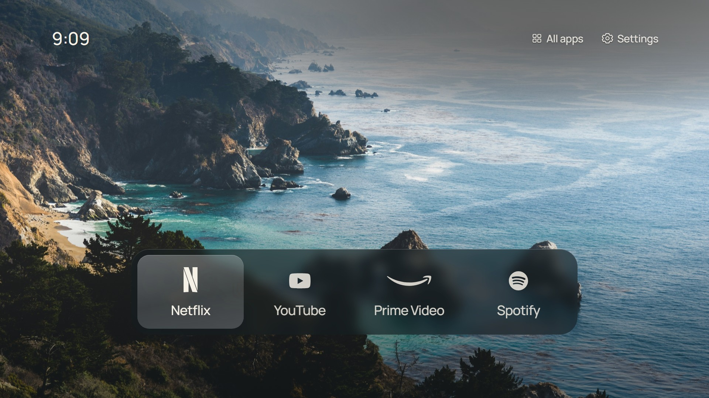
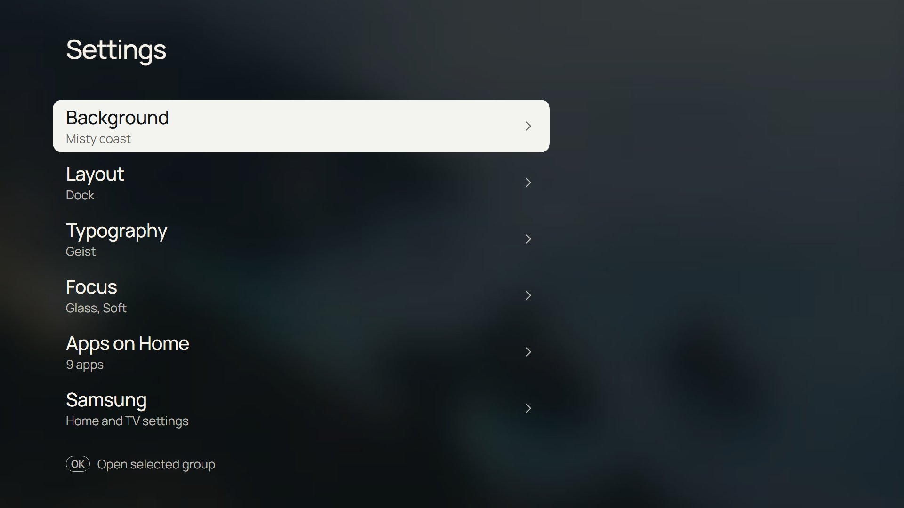
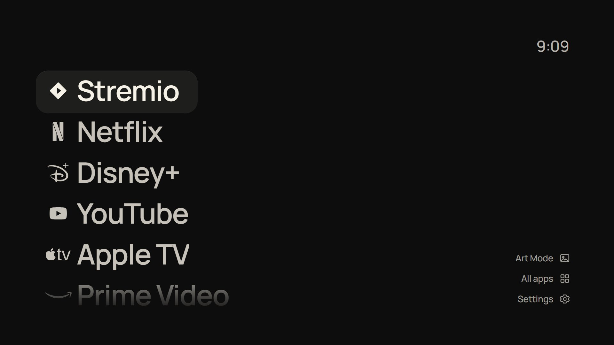

# CleanFrame para Samsung Tizen 3.0

Launcher con reloj, fondos y accesos a aplicaciones, sin Home Assistant ni root para el procedimiento descrito. Adaptación de [CleanFrame de Nathan Clark](https://github.com/nthnclrk/CleanFrame) por [soycaxte-lab](https://github.com/soycaxte-lab).



## Empieza aquí

- [Tutorial completo en español](docs/TUTORIAL-ES.md).
- [Solución de problemas](docs/PROBLEMAS-ES.md).
- [Prompt para hacerlo con un asistente](docs/PROMPT-ES.md).
- [Configuración de ejemplo](config/tv.example.json).

## Compatibilidad confirmada

El propietario confirmó las pruebas el 24 de octubre de 2026 en **Samsung UN75MU6103**, firmware **T-KTMUABC-1410.1**, **Tizen 3.0**, ARMv7. Motor detectado: SamsungBrowser 2.0 / Chromium 47.

| Función | Resultado en ese TV |
| --- | --- |
| Instalar widget firmado propio | Confirmado |
| Navegar con el control | Confirmado |
| Abrir Netflix, Prime Video y Spotify | Confirmado por el propietario |
| Abrir YouTube | Confirmado con `launchAppControl`, operación `view` |
| Abrir al encender | Confirmado dejando CleanFrame abierto antes de apagar y usando «última aplicación» |
| Exit desde otras apps vuelve al launcher | Pendiente; no implementado |
| Sustituir Home del sistema | No incluido |
| Otros modelos o firmware | Sin confirmar |

La guía está en español. La interfaz original conserva textos en inglés; no es una traducción completa de la app.

## Vista previa en PC

Requiere Node.js 22+ y Python 3.10+:

```sh
npm ci
npm run build:tizen3
npm run check
npm run dev:public
```

Abre `http://localhost:4795/home/?legacy=1`. Flechas, Enter y Escape permiten navegar. El navegador no puede abrir apps de la TV: instala el widget firmado para esa función.

## Más imágenes

Estas imágenes son capturas de la vista previa en PC de la adaptación, no fotografías de una TV ni pruebas adicionales de compatibilidad.





## Cambios

JavaScript ES5; alternativa a variables CSS, gap e inset; perfil configurable; apertura alternativa de YouTube; identidad independiente y herramientas Windows de instalación. Consulta las [notas técnicas](docs/TIZEN3.md).

Cada usuario debe crear sus certificados. No se distribuyen claves, contraseñas, certificados, datos de la TV ni widgets firmados para el aparato del autor. Las fuentes comerciales opcionales están excluidas.

## Créditos

Original: **Nathan Clark / nthnclrk**, licencia MIT. Adaptación y documentación: **soycaxte-lab**. Se conservan la historia, [licencia](LICENSE), [README original](docs/README-original.md) y [avisos de terceros](THIRD_PARTY_NOTICES.md). Fondos, fuentes y marcas conservan sus licencias y créditos. Proyecto independiente sin afiliación con Samsung ni los servicios mostrados.
